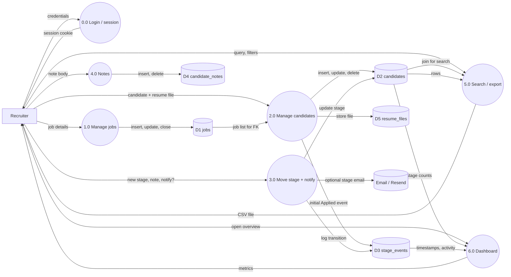
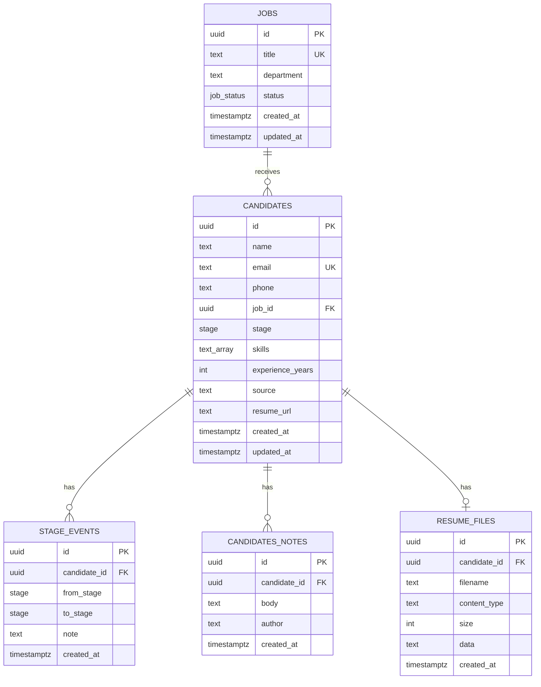

# Mini ATS: features, DFD and system design

## 1. Features

| Area | What it does |
|---|---|
| Authentication | Single recruiter login (`ADMIN_EMAIL` / `ADMIN_PASSWORD`), JWT session cookie, middleware guards all app routes |
| Job management | Separate `jobs` table (title, department, open/closed). CRUD + close/reopen/delete. Candidates must reference a job |
| Candidate management | Create, view, edit, delete. Name, email, phone, role (job FK), skills, experience, source |
| Resume upload | PDF/DOC/DOCX file ≤ 3 MB, magic-byte validation, stored base64 in Postgres, authenticated download API. Optional external resume/portfolio link |
| Notes | Multiple free-form notes per candidate (`candidate_notes`), with author and timestamp; delete any note |
| Hiring pipeline | Applied, Screening, Interview, Offer, Hired, Rejected, with a rule set for valid moves |
| Stage history | Every change stored in `stage_events` with from/to stage, note and timestamp |
| Email | New-candidate alert to admin; optional candidate stage-update email (Resend or console) |
| Search | Name, email, role title and skills (case-insensitive) |
| Filters and sort | Stage, job, newest, oldest, name, experience. Paginated, URL-driven |
| CSV export | Auth-guarded `/api/candidates/export` respects current filters |
| Dashboard | Totals, hire rate, average days to hire, per-stage counts, weekly applicants, top roles, recent activity |
| Board | Drag and drop between stages with optimistic updates |

## 2. Data flow diagram (level 1)

Export this block to PNG: paste into [mermaid.live](https://mermaid.live) and download, or run `npx @mermaid-js/mermaid-cli -i docs/dfd.mmd -o docs/dfd.png`.



## 3. Data model



Indexes: `jobs(status)`, `candidates(stage, job_id, created_at)`, `candidate_notes(candidate_id)`, `resume_files(candidate_id)`, `stage_events(candidate_id)`. Unique: `jobs(title)`, `candidates(email)`.

## 4. System design

```
Browser
  |  RSC payload / Server Action POST / authenticated file download
  v
Next.js middleware  -- unauthenticated -> /login
  |
  v
Next.js 16 (App Router)
  - Server Components read data directly (no REST layer needed)
  - Server Actions write data: requireUser -> Zod validate -> rules -> db.batch([...])
  - Route handlers: /api/resume/[id], /api/candidates/export (session-guarded)
  - Client Components only where interaction needs it: filters, forms, board, notes
  |  HTTPS (Neon serverless driver)
  v
NeonDB (Postgres)
```

**Key decisions**

- **Server Components and Server Actions over a REST API.** Fewer moving parts, types shared end to end.
- **Separate jobs table.** Role is a real entity with status; candidates hold a UUID FK, not free text.
- **Resume in Postgres as base64.** Keeps the stack to one database; files capped at 3 MB to stay under Vercel request limits; magic-byte check rejects renamed files.
- **Multiple notes table.** Notes are append-only rows with author + timestamp, not a single overwritten column.
- **Filters live in the URL.** Back button works, results are shareable.
- **Atomic stage changes.** Candidate update and history insert run in one `db.batch`.
- **Stage rules in one function** (`canMove`), used by server and UI.
- **Email is optional.** Without `RESEND_API_KEY`, emails log to the server console so local dev still works.
- **Lazy DB client.** `next build` works without a database connection.

**Request flows**

- *Login:* form -> `credentialsMatch` -> signed JWT cookie (`AUTH_SECRET`) -> redirect. Middleware checks the cookie on every request.
- *Move stage:* UI -> `changeStage(id, to, note, notify)` -> load current -> `canMove` -> batch -> optional `after(() => sendEmail)` -> revalidate.
- *Add candidate:* form + optional file -> validate -> job status check -> duplicate email check -> batch insert candidate + event + resume row -> admin email queued.
- *Export:* `/api/candidates/export?q=&stage=&job=` -> session check -> join query -> CSV response with Content-Disposition attachment.

**Edge cases handled:** duplicate email, invalid UUID (404), invalid stage transition, closed job cannot receive candidates, job with candidates cannot be deleted, oversized/malformed resume files, open-redirect on login `next` param, empty search results, failed optimistic board move (rollback), pagination reset on filter change, LIKE wildcards escaped.

**Tests (Vitest):** stage rules, candidate/job/note validators, resume size/type/signature checks, CSV escaping, `safeNext` and `credentialsMatch`.
