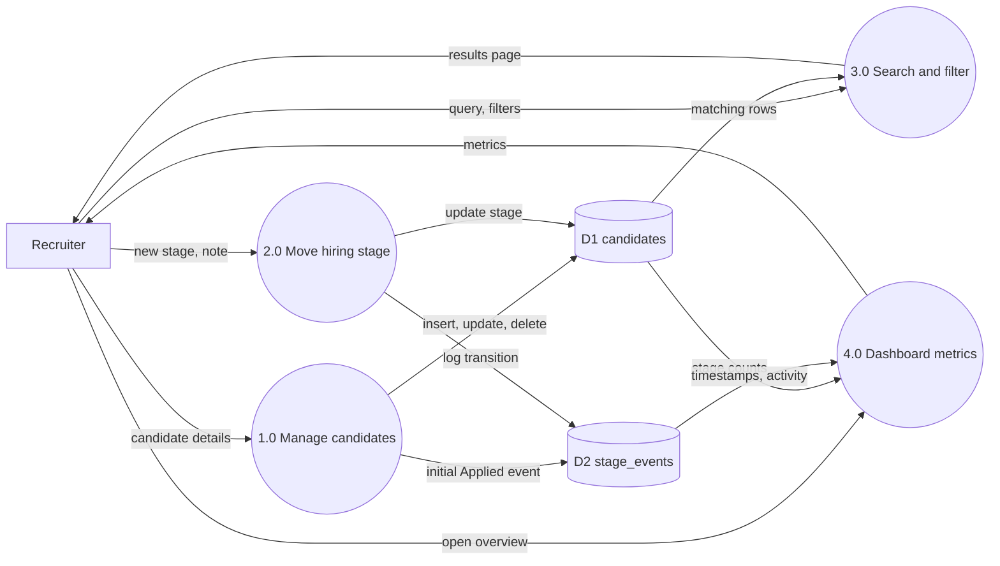
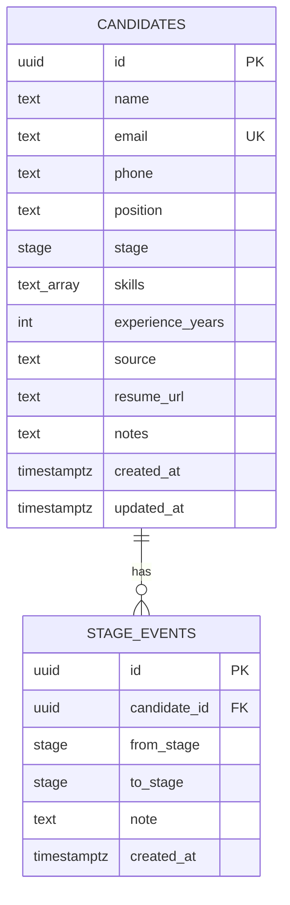

# Mini ATS: features, DFD and system design

## 1. Features

| Area | What it does |
|---|---|
| Candidate management | Create, view, edit, delete. Name, email, phone, role, skills, experience, source, resume link, notes |
| Hiring pipeline | Applied, Screening, Interview, Offer, Hired, Rejected, with a rule set for valid moves |
| Stage history | Every change stored in `stage_events` with from/to stage, note and timestamp |
| Search | Name, email, role and skills (case-insensitive) |
| Filters and sort | Stage, role, newest, oldest, name, experience. Paginated, URL-driven |
| Dashboard | Totals, hire rate, average days to hire, per-stage counts, weekly applicants, top roles, recent activity |
| Board | Drag and drop between stages |

## 2. Data flow diagram (level 1)



## 3. Data model



Indexes: `candidates(stage)`, `candidates(created_at)`, `stage_events(candidate_id)`, unique `candidates(email)`.

## 4. System design

```
Browser
  |  RSC payload / Server Action POST
  v
Next.js 16 (App Router)
  - Server Components read data directly (no REST layer needed)
  - Server Actions write data: validate (Zod) -> check rules -> db.batch([...])
  - Client Components only where interaction needs it: filters, form, board
  |  HTTPS (Neon serverless driver)
  v
NeonDB (Postgres)
```

**Key decisions**

- **Server Components and Server Actions over a REST API.** Fewer moving parts, types shared end to end, nothing to keep in sync.
- **Filters live in the URL.** Back button works, results are shareable, and the server renders the filtered page.
- **Atomic stage changes.** The candidate update and the history insert run in a single `db.batch`, so history can never drift from the current stage.
- **Validation on the server, always.** Zod schemas run in every action. The UI shows field-level errors from the same schema.
- **Stage rules in one function** (`canMove`), used by both the server and the UI so they cannot disagree.
- **Lazy DB client.** `next build` works without a database connection.

**Request flows**

- *Move stage:* UI calls `changeStage(id, to, note)` -> load current stage -> `canMove` -> batch (update + insert event) -> revalidate -> UI refreshes.
- *Search:* URL `?q=&stage=&position=&sort=&page=` -> Server Component -> one `WHERE` built from filters -> rows + count -> table + pagination.
- *Dashboard:* parallel queries (stage counts, last 8 weeks of applicants, top roles, recent events, hire durations) -> computed in `getDashboard`.

**Edge cases handled:** duplicate email, invalid UUID in URL (404), invalid stage transition, empty search results, empty database, failed optimistic move (rolls back), pagination reset on filter change, LIKE wildcard characters in search.

**Possible next steps:** authentication, resume file upload, per-job openings table, email notifications, CSV export, `pg_trgm` index for fuzzy search at scale.
